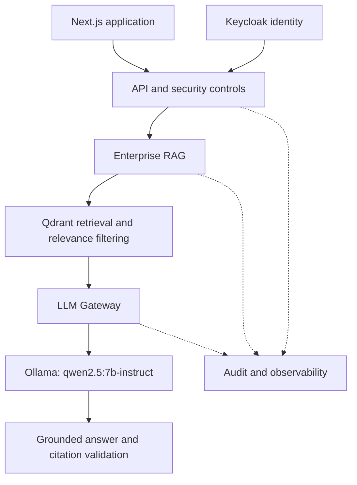

# HSAAI — Technical Portfolio & Verification Guide

**Haithim Nasher | Enterprise AI Platform Engineer & HSAAI Founder**

HSAAI is an independent, sovereign, self-hosted Enterprise AI Platform. This portfolio connects its architecture, engineering contributions, and reported results to reviewable evidence.

> **Evidence reviewed:** 20 October 2026. Results below distinguish repository-reported measurements from observed workflow status. No new tests were executed while preparing this document. Links and historical measurements should be rechecked against the repository before relying on them.

## Architecture

This diagram summarizes the documented authenticated RAG path. Active services depend on the deployment profile.



Reference: [Repository architecture](https://github.com/HSA-AI/HSAAI#architecture-overview).

## Verification evidence

| Item | Evidence and interpretation |
| --- | --- |
| Published release | [v4.0.0](https://github.com/HSA-AI/HSAAI/releases/tag/v4.0.0), release commit `80b7806`. |
| Release validation | [Release report](https://github.com/HSA-AI/HSAAI/blob/main/docs/reports/CURRENT_RELEASE_STATUS.md) reports 32/32 successful validations and 80.43% backend coverage. This does not establish that there are only 32 individual test cases. |
| Live local-model execution | [Run 36801647368](https://github.com/HSA-AI/HSAAI/actions/runs/36801647368), commit `3d0eb0b`: GitHub reportedly shows Success, 25m 6s, and one artifact. Artifact contents were not inspected for this portfolio. |
| External Kubernetes deployment | Environment-specific acceptance remains pending. |
| Demonstration video | Recording required. |
| Independent technical review | Review required. |

Historical results apply to their recorded commits. New changes require matching evidence.

## Reproduce backend tests

Use Linux with Python 3.12 and ripgrep installed. These commands follow the [coverage workflow](https://github.com/HSA-AI/HSAAI/blob/main/.github/workflows/production-coverage.yml), with an additional JUnit report:

```bash
git clone https://github.com/HSA-AI/HSAAI.git HSAAI-review
cd HSAAI-review
git checkout --detach c7b6111
git rev-parse HEAD

python3.12 -m venv .venv
. .venv/bin/activate

python -m pip install --upgrade pip
python -m pip install --no-cache-dir \
  -r requirements-validation.txt -r tests/requirements.txt
python -m pip install --no-cache-dir \
  pytest==8.4.2 pytest-cov cryptography

python -m pytest -q -ra \
  --cov-report=json:coverage.json \
  --junitxml=pytest-results.xml
```

This targets the reviewed repository snapshot, not release commit `80b7806`. The repository configuration reportedly enforces at least 80% coverage. Record the actual outcome, including failures and skipped tests.

Preserve:

- Full commit SHA and execution date.
- Runtime and dependency versions.
- Test totals, failures, skips, and exit status.
- Coverage JSON/XML and JUnit results.
- Workflow run URL, when executed through CI.

## Enterprise RAG and local LLM evaluation

The [repository overview](https://github.com/HSA-AI/HSAAI#validated-enterprise-ai-quality) reports these controlled-benchmark results:

| Metric | Reported result |
| --- | --- |
| Retrieval precision / recall | 100% / 100% |
| Citation precision / recall | 100% / 100% |
| Prompt-injection accuracy | 100% |
| LLM grounded rate | 100% |
| Required fact recall | 86.61% |

These percentages describe the controlled evaluation suite. They are not guarantees for arbitrary documents, questions, or deployment environments.

To reproduce live evaluation, open GitHub Actions → **HSAAI Live LLM Answer Quality** → **Run workflow**. Select the intended review branch and record the resolved commit.

The [live workflow](https://github.com/HSA-AI/HSAAI/blob/main/.github/workflows/live-llm-quality.yml) prepares the CI runtime and invokes the authenticated benchmark with:

```text
--mode live --min-cases 30 --require-retrieval-security --require-publishable
```

It uploads the `hsaai-live-llm-answer-quality` artifact. Attach the resulting machine-readable report, model identifier, dataset revision, and per-case results.

The separate AI Quality Benchmark workflow uses validation mode. Its success does not demonstrate live model execution.

## Security and permissions

The documented security model includes Keycloak/JWT authentication, RBAC/ABAC authorization, document access restrictions, tenant isolation, PII controls, and audit logging.

Reviewers should verify:

| Boundary | Required evidence |
| --- | --- |
| Authentication | Protected requests reject missing, invalid, and expired credentials. |
| Document authorization | Users cannot retrieve documents outside their granted access. |
| Tenant isolation | Cross-tenant retrieval is denied. |
| Input controls | Controlled unsafe inputs trigger the expected policy decision. |
| Auditability | Requests and access decisions can be traced without exposing credentials. |

[PR #22](https://github.com/HSA-AI/HSAAI/pull/22) documents authenticated retrieval, isolated benchmark identities, PII screening, and injection cases.

The repository’s security-scan workflow performs a focused credential scan. It does not constitute an independent penetration test.

## Personal engineering contributions

[AUTHORS.md](https://github.com/HSA-AI/HSAAI/blob/main/AUTHORS.md) identifies Haithim Nasher as the engineering and architecture lead. Reviewable merged contributions include:

| Contribution | Implementation record |
| --- | --- |
| Authenticated RAG retrieval and security benchmark | [PR #22](https://github.com/HSA-AI/HSAAI/pull/22) |
| Configurable cross-encoder relevance gate | [PR #24](https://github.com/HSA-AI/HSAAI/pull/24) |
| Live Ollama and LLM answer-quality validation | [PR #25](https://github.com/HSA-AI/HSAAI/pull/25) |

These records document implementation history. Integrated third-party technologies remain attributed to their upstream projects.

## Demonstration video

**Status:** Recording required.

| Time | Real demonstration |
| --- | --- |
| 0:00–0:30 | Show the commit SHA and active runtime services. |
| 0:30–1:10 | Sign in through the configured identity flow. |
| 1:10–2:15 | Upload a synthetic Arabic document, ask a question, and inspect citations. |
| 2:15–3:00 | Demonstrate a denied request from a user lacking document access. |
| 3:00–4:00 | Show the local model path, a request trace, and matching test evidence. |

Add the recording URL, date, and commit after recording the working deployment.

## Independent review

**Status:** Pending.

Requested review areas: security, Kubernetes deployment and reliability, and RAG evaluation.

Each review should identify the reviewer, commit, environment, scope, reproduction steps, findings, severity, and limitations. Link corrective commits and record retest outcomes. Publish reviewer attribution with consent.
